# Discover and connect to a BitChat Bluetooth peer



[Mermaid source](ble-connection.mmd) · [Model and source replay](../../.cursor/skills/verify-bitchat-ble-transport/SKILL.md)

Pstack explored eight states. `TrackedOnlyAfterNotify` held. `StopDisconnectsLink` broke after discovery, connection start, physical link opening, and transport shutdown while notifications were still being enabled. A local BLE double reproduced the missing disconnect call at both reviewed refs. The chart omits steps that stay in one chart state and abstracts radio timing, multiple peers and backend behavior.

From the repository root, with pstack's `statechart` command and TLC available, regenerate in a new directory. The command exits 1 for the known invariant violation.

```sh
skill=.cursor/skills/verify-bitchat-ble-transport
statechart "$skill/Central.tla" --config "$skill/Central-stop.cfg" \
  --view docs/statecharts/ble-connection.view.mjs --out /tmp/bitchat-ble-connection
```
