# Receive and save a BitChat file



[Mermaid source](file-receive.mmd) · [Model and local replay](../../.cursor/skills/verify-bitchat-file-transfer/SKILL.md)

Pstack explored 20 states. A four-step path breaks `DuplicateImpliesSaved`. The file is accepted, saving fails, the same transfer arrives again, and the receiver suppresses the retry while the file is still missing. A local fixture reproduced the receiver's behavior with an injected write error in both reviewed versions. The chart abstracts the transfer payload, transport timing and the filesystem, and omits steps that stay in one chart state.

```sh
skill=.cursor/skills/verify-bitchat-file-transfer
statechart "$skill/Incoming.tla" --config "$skill/Incoming-retry.cfg" \
  --view docs/statecharts/file-receive.view.mjs --out /tmp/bitchat-file-receive
```
