# Foreground and daemon radio ownership

[Mermaid chart](radio-lease.mmd) · [Verification skill and local replay](../../.cursor/skills/verify-bitchat-radio-lease/SKILL.md)



pstack's `/statechart` reached 91 distinct states and found that both launch paths can acquire the radio lease. In the shortest path, both check for an owner and see no live session. The first then records ownership, followed by the second. Both report success. The local fixture reproduced both success responses using the real lease class.

The chart groups sessions by their visible progress and hides steps that leave that progress unchanged. It ends at the radio lease boundary. Actual Bluetooth startup has separate outcomes.

To regenerate in a scratch directory, copy `RadioLease.tla` and `RadioLease.cfg` from the verification skill and copy `radio-lease.view.mjs` from this directory. Use pstack at `5866df557357d005b3c0c9d3da0d9e739b4bdde3` and the same pinned TLC JAR as the verification skill.

```sh
"$PSTACK_STATECHART" RadioLease.tla --view radio-lease.view.mjs --out bitchat-radio-lease
```
